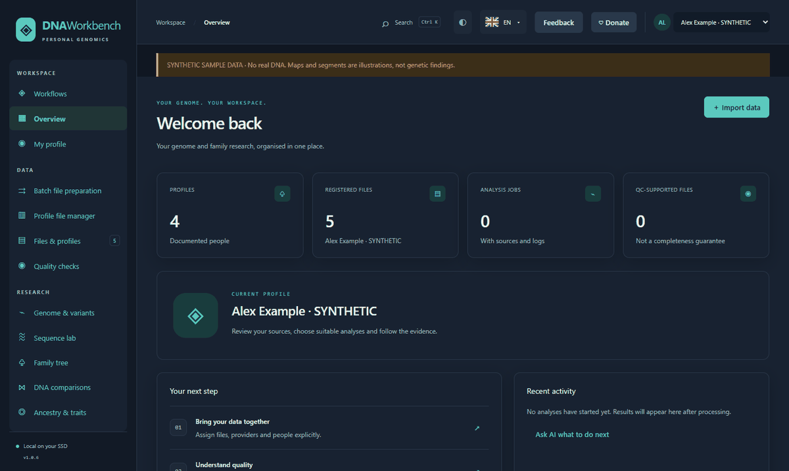

# DNA Workbench Suite

**Файлы ДНК, семейные записи и рабочие процессы исследований в одном локальном рабочем пространстве.**

[Скачать](https://github.com/oktay-du/DNA-Workbench-Suite/releases/latest) · [Веб-сайт](https://oktay-du.github.io/DNA-Workbench-Suite/?lang=ru) · [Руководство по установке](../GETTING_STARTED.md) · [Переводы](#translations)

Упорядочивайте свои источники по лицам и поставщикам, сравнивайте совместимые файлы и сохраняйте входные данные и результаты каждого анализа.



[Посмотреть тур по приложению](https://oktay-du.github.io/DNA-Workbench-Suite/?lang=ru#tour) · [Галерея скриншотов](../GALLERY.md)

## Что вы можете сделать

- Импортируйте файлы ДНК, папки и поддерживаемые архивы. Прежде чем копировать или перемещать что-либо, просмотрите поставщика, формат и эталонную сборку.
- Группируйте наборы данных, документы и результаты по профилям. Запишите происхождение каждого файла. Держите прямые измерения отдельно от предполагаемых значений и отмечайте, когда варианты были присвоены копиям хромосом.
- Проверьте качество выборки и сравните источники. Создайте версию BestDataset для рабочих процессов, которые могут использовать одну и ту же эталонную сборку.
- Исследуйте варианты и файлы последовательностей с помощью программ просмотра генома. Сравните профили ДНК и соедините исследовательские записи с семейными записями и файлами GEDCOM.
- Сохраняйте результаты вместе с входными данными и журналами. Экспортируйте отчеты и сохраняйте резервные копии профилей для последующего использования.
- Используйте дополнительный локальный помощник для навигации по рабочей области. Внешний AI можно настроить отдельно.

[Полный каталог функций](../FEATURES.md) · [Поддерживаемые форматы](../TOOL_FORMATS.md)

## Инструменты и что они делают

Это избранные инструменты, которые пакет интегрирует или может запускать. Доступность зависит от рабочего процесса и операционной системы. Некоторые модули и справочные данные загружаются отдельно.

| Инструмент | Что он делает |
| --- | --- |
| [SAMtools](https://www.htslib.org/) | Считывает, индексирует и проверяет согласованные файлы секвенирования в форматах SAM, BAM и CRAM. |
| [BCFtools](https://samtools.github.io/bcftools/) | Фильтрует, нормализует, объединяет и проверяет варианты файлов в форматах VCF и BCF. |
| [fastp](https://github.com/OpenGene/fastp) | Проверяет качество чтения FASTQ и может обрезать или фильтровать чтения. |
| [mosdepth](https://github.com/brentp/mosdepth) | Измеряет покрытие чтения из файлов BAM и CRAM. |
| [MultiQC](https://seqera.io/multiqc/) | Объединяет отчеты из нескольких инструментов контроля качества в одном представлении. |
| [PLINK](https://www.cog-genomics.org/plink/2.0/) | Работает с данными генотипа для таких задач, как фильтрация вариантов, родство и анализ главных компонентов. |
| [Beagle](https://faculty.washington.edu/browning/beagle/beagle.html) | Использует данные генотипа, чтобы сделать вывод, какие варианты лежат в одной и той же копии хромосомы. |
| [hap-ibd](https://github.com/browning-lab/hap-ibd) | Находит совпадающие сегменты ДНК, унаследованные от общего предка. Он использует данные генотипа с вариантами, присвоенными копиям хромосом. |
| [WhatsHap](https://github.com/whatshap/whatshap) | Использует считывания секвенирования для присвоения вариантов копиям хромосом. |
| [Truvari](https://github.com/ACEnglish/truvari) | Сравнивает структурные варианты в файлах VCF. |
| [IGV](https://igv.org/doc/desktop/) | Отображает совмещенные чтения, варианты и другие треки генома в определенных местах. |
| [JBrowse](https://jbrowse.org/jb2/) | Позволяет просматривать эталонные последовательности и связанные треки в интерактивном режиме. |
| [GenomeSpy](https://genomespy.app/) | Отрисовывает интерактивные геномные диаграммы с графическим ускорением браузера. |
| [Gramps](https://www.gramps-project.org/) | Организует генеалогические записи, генеалогические деревья и данные GEDCOM. |
| [OpenCRAVAT](https://docs.opencravat.org/en/latest/Home.html) | Аннотирует варианты, используя выбираемые источники и аннотаторы. |
| [Ensembl VEP](https://www.ensembl.org/info/docs/tools/vep/index.html) | Предсказывает, как варианты могут влиять на гены, транскрипты и белки. |
| [PharmCAT](https://pharmcat.org/) | Создает отчеты о фармакогенетических исследованиях на основе поддерживаемых входных данных генотипа. |
| [llama.cpp](https://github.com/ggml-org/llama.cpp) | Запускает дополнительную модель локального языка в совместимых средах выполнения ЦП и ГП. |

[Версии инструмента и необходимые условия](../VERSIONS.md)

## Начать

Выберите пакет, соответствующий вашей операционной системе и процессору. На странице выпуска перечислены загрузки x64 и ARM64 для Windows, Linux и macOS. Некоторые сборки являются превью.

1. На Windows распакуйте архив и запустите лаунчер. Завершите настройку ядра, когда будет предложено.
2. На Linux запустите включенную программу запуска оболочки с установленными Python, GTK и WebKitGTK.
3. В macOS храните приложение рядом с извлеченными файлами рабочей области. Для предварительной версии требуется macOS 13 или новее и Python 3.12 или новее.
4. Начните с прилагаемых синтетических образцов, чтобы опробовать рабочие процессы без использования личных файлов.

[Скачать](https://github.com/oktay-du/DNA-Workbench-Suite/releases/latest) · [Руководство по установке](../GETTING_STARTED.md)

## Командная строка и автоматизация

Используйте тот же реестр команд через интерфейс рабочего стола: CLI, JSON-RPC и MCP. Безголовая служба работает на локальном компьютере. Вы можете перечислять команды и читать их схемы, не открывая окно рабочего стола.

```text
python DNA_Software/Launcher/dna_cli.py commands
python DNA_Software/Launcher/dna_cli.py serve
```

Дополнительный помощник может помочь вам ориентироваться в результатах. Его ответы не заменяют исходные данные или проверенный анализ.

> Исследовательское программное обеспечение. Результаты зависят от входных данных, метода и ссылок. DNA Workbench Suite не дает клинического диагноза.

## Проект и поддержка

Поддерживается Oktay Du / OD при помощи ИИ.

[Конфиденциальность](../PRIVACY.md) · [Безопасность](../../SECURITY.md) · [Лицензия проекта](../../LICENSE) · [Сообщить о проблеме](https://github.com/oktay-du/DNA-Workbench-Suite/issues/new/choose)

Поддержать проект · [Buy Me a Coffee](https://buymeacoffee.com/okioki) · [NOWPayments](https://nowpayments.io/donation/oktayd) · [Patreon](https://www.patreon.com/Oktaydu/gift)

<a name="translations"></a>

## Переводы

Приложение включает 36 языков автономного интерфейса. Выберите перевод страницы этого проекта ниже.

[Deutsch](../../README.de.md) · [English](../../README.md) · [Türkçe](README.tr.md) · [Español](README.es.md) · [Français](README.fr.md) · [Português](README.pt.md) · [Italiano](README.it.md) · [Nederlands](README.nl.md) · [Svenska](README.sv.md) · [Ελληνικά](README.el.md) · [Čeština](README.cs.md) · [Română](README.ro.md) · [Magyar](README.hu.md) · [Polski](README.pl.md) · [Українська](README.uk.md) · [Русский](README.ru.md) · [العربية](README.ar.md) · [فارسی](README.fa.md) · [اردو](README.ur.md) · [हिन्दी](README.hi.md) · [नेपाली](README.ne.md) · [ქართული](README.ka.md) · [Հայերեն](README.hy.md) · [Монгол](README.mn.md) · [简体中文](README.zh-Hans.md) · [日本語](README.ja.md) · [한국어](README.ko.md) · [Bahasa Indonesia](README.id.md) · [Bahasa Melayu](README.ms.md) · [Tiếng Việt](README.vi.md) · [ไทย](README.th.md) · [Filipino](README.fil.md) · [አማርኛ](README.am.md) · [Kiswahili](README.sw.md) · [Soomaali](README.so.md) · [Hausa](README.ha.md)
